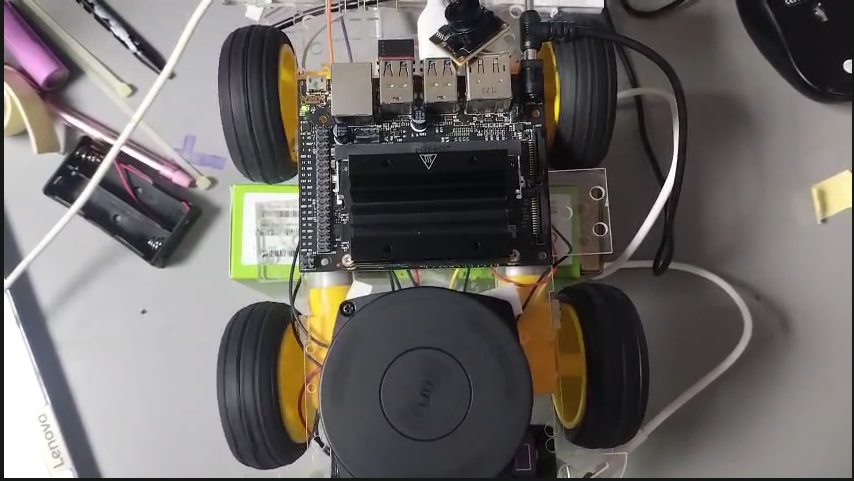
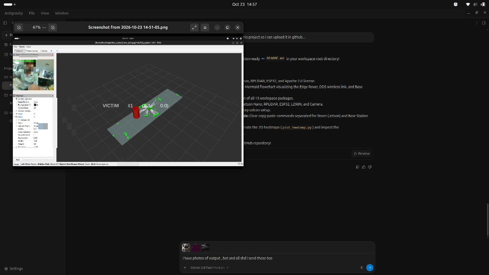
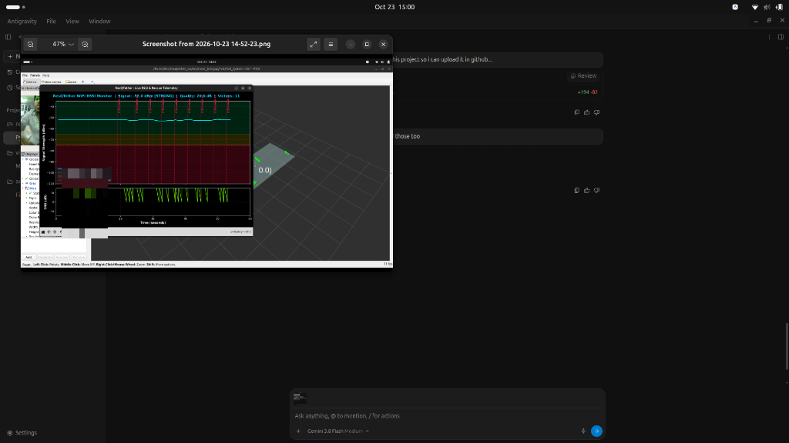
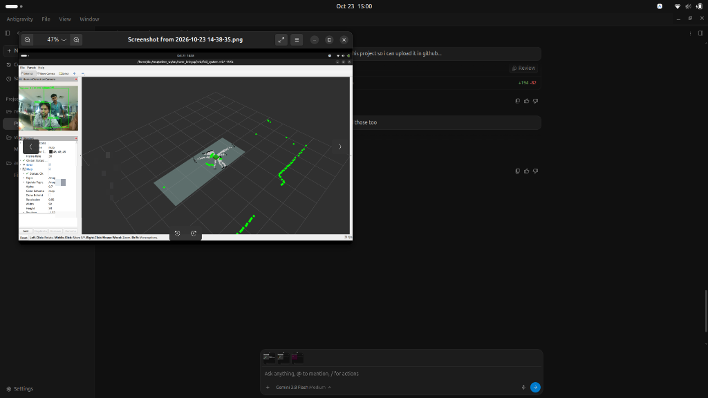
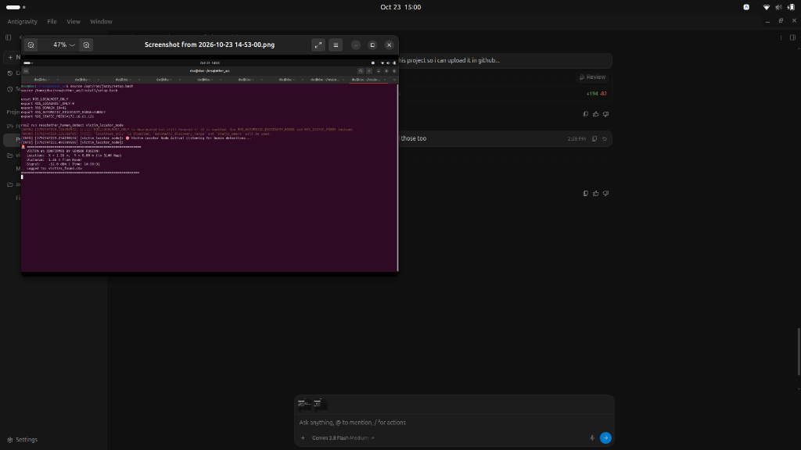
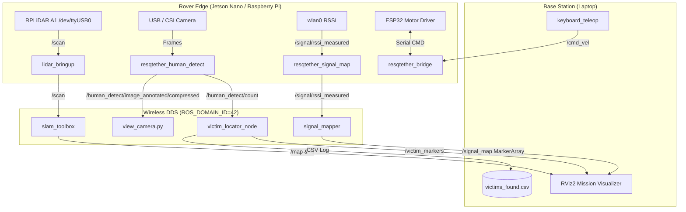

# 🛰️ ResQTether: Autonomous Search & Rescue Rover System

[](https://docs.ros.org/en/jazzy/)
[]()
[]()
[](LICENSE)

An intelligent, tetherless disaster-response and search-and-rescue rover platform. **ResQTether** fuses **2D LiDAR SLAM**, **asynchronous Computer Vision**, **real-time RF signal strength mapping (WiFi/LoRa)**, and **Sensor-Fusion Victim Localization** to map unknown collapsed environments and accurately pinpoint victims in real-time.

---

## 📸 System Showcase & Live Demonstration

<div align="center">
  <h3>🤖 Rover Hardware Platform</h3>
  
  <p><em>NVIDIA Jetson Nano + SLAMTEC RPLiDAR A1 + CSI Camera + 4WD Differential Chassis & ESP32 Bridge</em></p>
</div>

<br/>

### 🎯 Sensor-Fusion Victim Localization & Live SLAM Mapping

| 📍 3D Victim Pinning in RViz | 📡 Real-Time RF Telemetry & Zones |
|:---:|:---:|
|  |  |
| **Exact $(X, Y)$ Victim Pin Drop on SLAM Map** | **Rolling Signal Strength & Quality Monitoring** |

| 👥 Multi-Human Detection & SLAM | 🚨 Terminal Sensor-Fusion Alert |
|:---:|:---:|
|  |  |
| **Real-time 30 FPS Multi-Target Detection** | **Instant Sensor-Fusion Coordinate Confirmation** |

---

## 🌟 Key Features

1. **Autonomous 2D SLAM Mapping:**
   - Real-time floorplan reconstruction using `slam_toolbox` and RPLiDAR A1/A2.
   - Laser scan matching and graph optimization running asynchronously.

2. **3D Signal Strength Mapping (RF Heatmap):**
   - Continuously samples real RSSI values (WiFi/LoRa) during rover traversal.
   - Fuses signal metrics with 2D SLAM pose transforms (`map -> base_link`).
   - Renders 3D color-coded voxel cubes (Green = Strong, Yellow = Marginal, Red = Dead Zone) directly in RViz and generates high-resolution offline 2D heatmaps.

3. **Asynchronous Human Detection & Sensor-Fused Victim Locator:**
   - Multi-scale real-time detector (Face, Profile, Upper Body, and HOG/YOLO) with high-speed JPEG network streaming.
   - **Victim Locator:** Fuses camera detections, front LiDAR distance, and SLAM heading to compute **exact real-world $(X, Y)$ map coordinates** of trapped victims and drops interactive 3D Red Beacon pins in RViz.
   - Automatically logs timestamp, coordinates, and signal levels to `victims_found.csv`.

4. **Distributed Edge-Base Architecture:**
   - Native ROS 2 DDS communication between Edge Computer (**NVIDIA Jetson Nano / Raspberry Pi**) and Base Station (**Laptop**).
   - Prevents compute/power throttling on the rover by dynamically splitting sensor acquisition from heavy graph optimization.

5. **ESP32 Hardware Motor Bridge & Teleoperation:**
   - Serial bridge with software watchdog and automatic disconnection recovery.
   - WASD momentary keyboard teleoperation for responsive manual steering.

---

## 🏗️ System Architecture



---

## 📦 Workspace Package Structure

| Package | Description |
| :--- | :--- |
| **`lidar_bringup`** | Driver configuration and launch files for RPLiDAR A1/A2 (`rplidar_composition`). |
| **`slam_bringup`** | Configures `slam_toolbox`, static TF frames (`odom -> base_link -> laser_link`), and Nav2 lifecycle manager. |
| **`resqtether_human_detect`** | Multi-scale human detection, 30 FPS MJPEG network streamer, and `victim_locator_node`. |
| **`resqtether_signal_map`** | Real WiFi RSSI extraction (`wlan0`) and live dark-mode telemetry visualizer (`plot_rssi.py`). |
| **`signal_mapper`** | SLAM-Signal fusion node producing 3D voxel markers (`/signal_map`) and floorplan heatmaps (`plot_heatmap.py`). |
| **`resqtether_bridge`** | High-performance ROS 2 to ESP32 serial bridge with watchdog auto-stop. |
| **`resqtether_dashboard`** | Unified HTTP web mission control (camera, 2D radar, telemetry graph, and teleop). |
| **`rover_bringup`** | Unified launch files, RViz presets, and WASD teleoperation scripts. |
| **`resqtether_interfaces`** | Custom ROS 2 msg definitions (`LoraStatus.msg`, `VictimAlert.msg`). |

---

## 🛠️ Hardware Requirements

* **Edge Compute:** NVIDIA Jetson Nano (4GB Developer Kit with 5V/4A Barrel Jack) or Raspberry Pi 4 (4GB/8GB).
* **LiDAR:** SLAMTEC RPLiDAR A1 (or A2/A3/C1).
* **Camera:** USB UVC Web Camera (720p/1080p) or IMX219 CSI Camera.
* **Microcontroller:** ESP32 DevKit V1 (30-pin) for L298N motor PWM control.
* **Chassis & Drive:** 2WD / 4WD RC Rover chassis with DC gear motors.
* **Base Station:** Linux Laptop (Ubuntu 24.04 / 22.04 with ROS 2 Jazzy or Iron/Humble).

---

## 🚀 Installation & Build

### 1. Prerequisites (Ubuntu & ROS 2)
Make sure you have ROS 2 Jazzy installed:
```bash
sudo apt update
sudo apt install -y python3-colcon-common-extensions \
                    ros-jazzy-slam-toolbox \
                    ros-jazzy-nav2-lifecycle-manager \
                    ros-jazzy-rplidar-ros \
                    ros-jazzy-cv-bridge \
                    python3-serial \
                    python3-matplotlib \
                    python3-pil
```

### 2. Clone & Build
```bash
mkdir -p ~/resqtether_ws/src
cd ~/resqtether_ws/src
git clone https://github.com/your-username/resqtether.git .
cd ~/resqtether_ws

source /opt/ros/jazzy/setup.bash
colcon build --symlink-install
source install/setup.bash
```

---

## 💻 Running the Distributed System

Always configure your network environment in every terminal:
```bash
export ROS_DOMAIN_ID=42
export ROS_AUTOMATIC_DISCOVERY_RANGE=SUBNET
export ROS_STATIC_PEERS=<OTHER_MACHINE_IP>
```

### Step 1: On the Rover (Jetson / Pi)
```bash
# Terminal 1: RPLiDAR
ros2 launch lidar_bringup lidar.launch.py serial_port:=/dev/ttyUSB0

# Terminal 2: Camera & Human Detection
ros2 launch resqtether_human_detect human_detect.launch.py camera_index:=0

# Terminal 3: WiFi RSSI Monitor
ros2 run resqtether_signal_map real_rssi_node

# Terminal 4: ESP32 Motor Bridge (Optional)
ros2 run resqtether_bridge bridge_node --ros-args -p port:=/dev/ttyUSB1
```

### Step 2: On the Base Station (Laptop)
```bash
# Terminal 1: SLAM Floorplan Mapping
ros2 launch slam_bringup slam.launch.py

# Terminal 2: 3D Signal Cube Fuser
ros2 run signal_mapper fuse_node

# Terminal 3: Sensor-Fused Victim Locator
ros2 run resqtether_human_detect victim_locator_node

# Terminal 4: RViz2 Master Display
rviz2 -d /home/dsc/resqtether_ws/src/rover_bringup/rviz/full_system.rviz

# Terminal 5: Standalone Camera Stream
python3 src/resqtether_human_detect/scripts/view_camera.py

# Terminal 6: Drive Rover (WASD)
ros2 run rover_bringup keyboard_teleop
```

---

## 📊 Telemetry & Data Analysis

### 1. Generating High-Resolution 2D RF Heatmaps
After running an exploration session, generate a color-coded signal strength distribution map overlaid on your SLAM floorplan:
```bash
python3 src/signal_mapper/signal_mapper/plot_heatmap.py
```
*Outputs: `signal_heatmap.png`*

### 2. Victim Location Log
Every detected human is recorded to `victims_found.csv`:
```csv
victim_id,timestamp,victim_x,victim_y,robot_x,robot_y,rssi_dbm
1,14:51:12,1.35,0.02,0.15,-0.01,-48.0
2,14:53:40,3.82,1.45,2.60,1.10,-68.5
```

---

## 📜 License
Distributed under the **Apache 2.0 License**. See `LICENSE` for more information.

---

## 👥 Contributors & Acknowledgments
* **Author / Maintainer:** Chaathura ([@chaathura](https://github.com/your-username))
* **ROS 2 Robotics & Embedded Systems Research**
